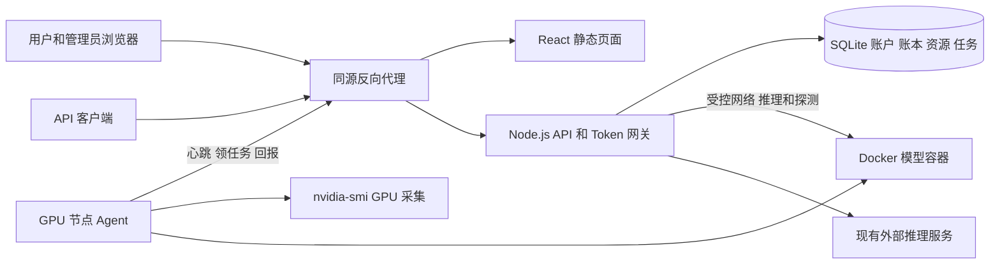

# CoreMatrix 系统架构

现阶段保留一个 React 应用、一个 Node.js API 进程和 SQLite。GPU 主机运行本项目的轻量 Go Agent，通过拉取任务管理 Docker 模型容器，避免让管理端直接执行 SSH 或任意 Shell。

## 当前代码结构

| 位置                   | 已实现职责                                        |
| ---------------------- | ------------------------------------------------- |
| `src/App.tsx`          | Hash 路由、会话状态、API 数据刷新、管理台访问保护 |
| `src/context.tsx`      | 共享状态、接口变更与通知                          |
| `src/api.ts`           | 同源请求、CSRF、Idempotency-Key、错误处理         |
| `src/domain.ts`        | 前后端共享数据类型和金额展示                      |
| `src/pages/`           | 用户和管理员页面                                  |
| `server/app.ts`        | HTTP 路由、鉴权、模型管理、网关与结算             |
| `server/store.ts`      | SQLite、事务、账户和运营状态汇总                  |
| `server/auth.ts`       | 密码哈希、Token 生成及摘要                        |
| `server/validation.ts` | 参数、模型配置、地址白名单和费用计算              |
| `tests/`               | 业务单测和 HTTP 集成测试                          |

## 目标拓扑

以下 Agent、任务和受管路由已实现代码及协议测试，真机验收尚待执行。

浏览器不能访问 Docker API，也不接收节点运行凭证。GPU 节点主动访问控制面；网关同时必须能够访问节点发布的推理端口。只有出站访问而没有推理回程的节点不能标记为可服务。

## 职责边界

### 控制面

控制面负责服务器登记、Agent 身份、资源预留、任务状态、部署切换及路由决策。GPU/端口预留、创建部署和创建任务必须处于同一数据库事务。

### 节点 Agent

Agent 使用 Go 标准库实现 HTTPS 通信、子进程调用和本地状态。只执行结构化的启动、检查、停止任务；固定运行环境为 Linux、NVIDIA 驱动、Docker 和 NVIDIA Container Toolkit。

Agent 仅管理具有平台标签的容器。Docker 权限具有较高主机权限，因此节点 Token、Agent 安装目录及运行账号必须由运维控制。

### 推理容器

首版运行已固定版本或 digest 的 `vllm/vllm-openai` 镜像。vLLM 提供 OpenAI 兼容服务，可用于现有网关；实际镜像、驱动和模型兼容性需在节点验收。[vLLM Docker 文档](https://docs.vllm.ai/en/latest/deployment/docker/)

### Token 网关

现有预留、结算、预算、幂等与价格快照保持不变。增加路由选择后，先确认健康目标，再预留费用；请求开始时固定目标部署，不在已经发送请求后盲目重试到另一实例。

## 路由模式

为模型增加 `routingMode`，旧记录迁移默认值为 `external`。

| 模式       | 目标来源                         | 无可用目标时                          |
| ---------- | -------------------------------- | ------------------------------------- |
| `external` | 当前手工配置的 `upstreamUrl`     | 保持现有未配置或上游失败行为          |
| `managed`  | 本平台的就绪部署及健康、节点状态 | 503，不回退到可能指向其他模型的旧 URL |

受管目标必须满足：模型已上架、部署 ready、节点在线且非禁用、部署未 draining、健康结果未过期。维护模式禁止新部署，但已就绪实例仍可接流；完全停流要显式停止部署或禁用节点。

首版从合格实例中选择在途请求数最少者，平局用部署 ID 排序。`requests.deploymentId` 持久化路由选择，处理中请求数可由数据库推导，无需引入 Redis。在费用预留事务内重新确认所选部署仍为 ready 且未 draining，避免路由选择和旧实例退役之间出现竞态。

## 事务与外部动作

数据库事务不能包住 Docker 操作或网络请求。控制面先提交“资源已预留、任务已排队”，Agent 执行后再通过回报推进状态。任务回报包含任务 ID、尝试号和租约凭证，旧租约不能推进新状态。

计费的请求结果保存与实际收费在同一事务；部署的 ready 切换和旧部署 draining 标记在同一事务。容器停止确认与 GPU 释放也必须原子更新。

## 关键技术决策

| 决策         | 首版选择                | 升级条件                                            |
| ------------ | ----------------------- | --------------------------------------------------- |
| Web 和 API   | 沿用当前 React、Node.js | 业务规模或团队分工需要再拆分                        |
| 数据库       | SQLite 单写实例         | API 多副本、写竞争或高可用要求出现时迁移 PostgreSQL |
| 任务         | SQLite 持久化任务和租约 | 跨区域和多调度器出现时引入独立队列                  |
| 节点控制     | Agent 拉取结构化任务    | 不将 SSH 密码写入平台                               |
| GPU 共享     | 首版整卡独占            | MIG 和时间片须单独设计资源隔离和计费                |
| 模型并行     | 单机多卡                | 跨机并行需增加网络拓扑和分布式生命周期              |
| 模型切换     | 有富余资源时滚动切换    | 原地停机切换须独立显示停机影响并新增流程            |
| GPU 资源数量 | Agent 实测库存          | 手工登记只提供节点元数据                            |

## 网络和密钥

外部 URL 保持 `INFERENCE_ALLOWED_ORIGINS` 精确白名单。受管部署的地址只能由管理员登记的节点主机与平台分配的端口生成；Agent 回报不得提供任意 URL让网关访问。新增受管地址验证策略时不得放宽现有外部 URL 校验。

首版受管推理共享密钥由运维分别配置到控制面和节点环境，模型配置只存 `apiKeyEnv` 变量名。Agent Token 只能访问本节点接口，不能代替推理 API Key。服务端只保存节点 Token 摘要，一次明文展示丢失后通过轮换处理。

## 故障原则

节点离线立即从新请求候选中剔除，但保留 GPU 占用。Agent 恢复后先回报完整容器清单并对账，再接收新的任务。任务租约过期代表执行结果不确定，不能自动声明容器已经停止。

当前 Token 请求重启恢复规则只针对 `requests` 表，不可直接复用于部署任务；部署任务需要通过 Agent 清单恢复。新增代码应避免管理员初始化命令误触发任务恢复。
