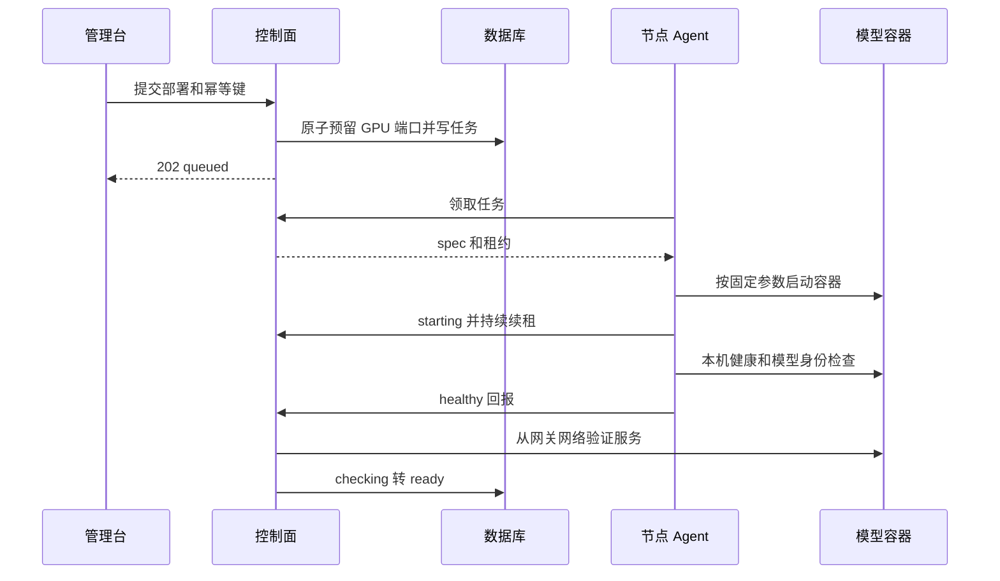
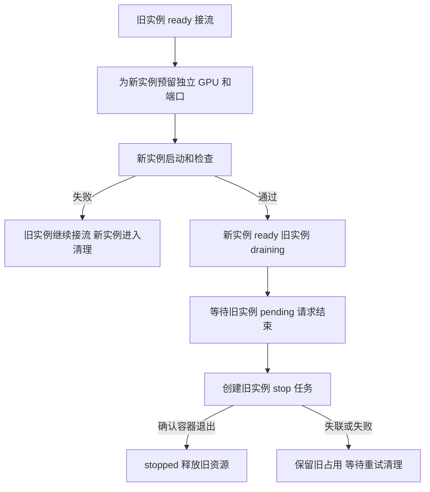

# CoreMatrix 服务器与模型部署设计

本章的节点协议、Go Agent、Docker 执行器和管理页面已实现，真实 GPU 验收仍待执行。接入操作见 [Agent 手册](../agent/README.md)。当前实现覆盖“节点上报真实 GPU → 平台预留 → Agent 启动 → 健康确认 → 网关接流 → 安全停止”的完整链路。

## 节点环境

用户已确认采用 Linux、NVIDIA GPU 和 Docker。Agent 使用 Go 标准库编译为 Linux 静态二进制，节点无需安装 Go 或 Python；平台 API 继续使用现有 Node.js。

需要安装 NVIDIA 驱动及 NVIDIA Container Toolkit，并实际验证容器可见 GPU；不能只以 Docker 已安装判断 GPU 容器可用。[NVIDIA Container Toolkit 安装指南](https://docs.nvidia.com/datacenter/cloud-native/container-toolkit/latest/install-guide.html)

Agent 启动检查包括 nvidia-smi、Docker daemon、镜像拉取权限、模型缓存目录、端口范围、磁盘余量、控制面连通性。检查结果随心跳回报，包括实际镜像 digest；没有 GPU 或存在 MIG 模式时首版拒绝整卡调度并解释原因。

## Agent 配置

实际环境文件和 systemd 启动方式见 Agent 手册。

| 配置                       | 说明                                                                          |
| -------------------------- | ----------------------------------------------------------------------------- |
| COREMATRIX_URL             | 控制面 HTTPS URL；本机测试可用 HTTP                                           |
| COREMATRIX_AGENT_TOKEN     | 本节点专用 Token，仅保存到受限环境文件                                        |
| COREMATRIX_AGENT_STATE_DIR | 本地 Agent 锁目录；任务保存在控制面，容器按标签对账                           |
| COREMATRIX_RUNTIME_IMAGE   | 经验证并固定 repo@sha256:digest 的 vLLM 镜像；实现要求 digest，不接受可变 tag |
| COREMATRIX_MODEL_DIR       | 节点受控模型目录，仅允许挂载此目录                                            |
| COREMATRIX_SHM_SIZE        | 节点受控共享内存尺寸，按真机模型测试配置                                      |
| COREMATRIX_CACHE_DIR       | Hugging Face 和引擎缓存目录                                                   |
| INFERENCE_NODE_KEY         | 示例推理服务密钥变量；实际名字必须与模型 apiKeyEnv 对应                       |

控制面与节点的推理密钥由运维分别配置同一值，任务只传变量名。Token 和密码不出现在命令行参数、日志、事件和文档示例中。

同一节点只运行一个 Agent，通过本地文件锁和服务端 instance/generation 双重约束。Agent 使用 systemd 等进程管理方式运行；控制面断开不能导致后台主循环退出后永久不重试。

## GPU 采集与调度资格

建议查询命令：

```sh
nvidia-smi --query-gpu=index,uuid,name,memory.total,memory.used,utilization.gpu,temperature.gpu --format=csv,noheader,nounits
```

使用 CSV 解析器，处理空输出、非零退出、N/A、传感器缺失和超时。UUID 用于持久身份，index 仅展示。[NVIDIA SMI 文档](https://docs.nvidia.com/deploy/nvidia-smi/index.html)

可调度 GPU 必须同时满足：最新库存中存在、节点在线且允许调度、没有活跃 allocation、没有不属于平台的计算进程、实际显存满足 runtime.minGpuMemoryMiB。GPU 利用率低或显存暂时空闲不能覆盖已分配状态。

物理身份按 GPU UUID 跨节点登记判断。同一 UUID 出现在多个未删除节点的非缺失库存，或与其他节点的未释放 allocation 重叠时，相关节点返回 `inventoryError: duplicate_gpu_identity`、可用卡数为 0，暂停新销售、管理员分配、预约派发、启动任务领取、续费及推理接流。既有租约不能凭此释放资源；停止任务领取、库存确认、到期回收和退费仍保留。管理页面提供四语言提示，物理 GPU 总数和已分配数按 UUID 去重。

心跳过期不能解除身份冲突。确认重复登记后，先核实物理主机和容器：无部署、占用、任务或预约的旧登记可以删除；有占用的登记必须按原节点完成停止和清理。不要直接删除 allocation、清空库存或手改缺失标记。库存中确认消失的 GPU 仍受未释放 allocation 和跨节点预约时间窗约束。历史重复占用只读报告为 `duplicate_gpu_allocation`，不会自动选择一个记录作为赢家，也不会自动扣款或退款。

采集失败时显示错误和上次成功时间，将资源设为不可调度，不清空历史占用。物理设备减少时标记 missing，等运维处理。

## 默认时序

以下参数是首版默认设计，后续根据实测调整并同步契约。

| 参数             | 默认值                                                  |
| ---------------- | ------------------------------------------------------- |
| 心跳间隔         | 10 秒                                                   |
| 任务轮询         | 5 秒，无任务时可退避到 15 秒                            |
| 节点离线阈值     | 45 秒未收到有效心跳                                     |
| 任务租约         | 60 秒                                                   |
| 续租间隔         | 20 秒                                                   |
| 启动截止时间     | 20 分钟，包括拉取和加载；超过后转未知或清理，不直接释放 |
| ready 后健康探测 | 每 15 秒一次                                            |
| 健康结果失效     | 45 秒                                                   |
| 旧实例排空上限   | 120 秒，高于当前单次网关默认超时                        |

启动执行和心跳必须并行，避免 Docker 拉镜像阻塞心跳造成误离线。租约截止时间来自服务端；本地使用单调时钟计算剩余执行窗口。

## 资源预留

创建部署事务中完成以下检查和写入：

1. 验证模型 runtime 完整且目标节点可调度。
2. 校验所有 GPU UUID 属于该节点、数量符合模板，且无外部占用。
3. 校验已测量的显存和必要的同机卡型/互联兼容性；不跨节点凑卡。
4. 在同一 SQLite `BEGIN IMMEDIATE` 事务中检查跨节点物理身份和预约，再为每张 GPU 写入活跃 allocation。`active_gpu(serverId,uuid)` 保留节点内唯一约束；跨登记保护由共享身份/时间窗检查完成，不通过删除历史记录强建全局唯一索引。当前部署仍限定单 API 实例。
5. 从节点允许范围选择空闲端口并预留。
6. 保存 deployment spec（包含节点已验证镜像 digest）、期望 running 和 start job。

任何一步失败则整个事务回滚。相同幂等请求返回原 deployment；不创建第二套占用。

## 启动流程



Agent 以 `corematrix.deployment=<id>`、`corematrix.job=<id>` 和 spec 摘要标签识别容器。执行前先检查同部署容器是否已存在且参数一致；重复任务不能启动第二个容器。

通过参数数组调用 Docker，禁止 `shell=True` 和拼接执行。任务不得传任意 Docker 参数、镜像、宿主路径或 `--privileged`。任务内预期镜像 digest 必须匹配 Agent 本地受控配置，否则拒绝执行并回报模板不兼容。GPU 按 UUID 显式选择，不把所有卡暴露给单个实例。模型来源只能是合法仓库 ID 或受控 `/models/` 挂载目录，拒绝路径穿越和默认执行远程模型代码。

运行配置至少包含 model、served-model-name、tensor-parallel-size、dtype、max-model-len、绑定端口、模型缓存和推理认证。vLLM 多进程推理需要正确配置共享内存；共享内存大小作为节点受控模板参数，不直接套用未经验证的固定值。[vLLM Docker 文档](https://docs.vllm.ai/en/latest/deployment/docker/)

## 健康与路由

健康检查依次确认：容器仍存在且没有退出、本机服务可访问、服务模型 ID 与 spec 一致、控制面能够经过受控网络访问它。真实文本探测通过后再 ready；探测为平台内部请求，不生成用户消费账单。

Agent 的 healthy 事件不能直接写 ready。控制面完成异步探测后，在最终事务中再次确认 desiredState、generation、租约和替换链仍有效，避免“停止请求已提交后，旧探测把实例重新上线”。

最终 URL 从已登记节点和平台预留端口生成；不信任 Agent 上报任意 URL。网关只路由到新鲜 healthy 的 ready 实例，并把 deploymentId 保存到本次费用预留记录。

## 滚动切换



一次旧部署只允许一个活跃替换。新旧部署可在同机不同 GPU 或不同节点；不能把旧占用视为空闲资源。没有富余资源时返回冲突，首版不做隐式停机切换。

不同模型之间切换遵循平台模型 ID：新实例只服务它自己的 ID。旧 ID 若没有其他就绪部署，应显示不可调用。不要直接覆盖旧模型 URL 指向新模型。

切流后旧部署停止接收新请求；通过 `requests.deploymentId AND status=pending` 判断排空。当前排空超过设计参考 120 秒仍继续等待在途请求，并由运维查明原因，不自动杀死仍在输出的进程；强制停止是后续显式操作，不纳入首版默认行为。

## 状态转换

| 当前状态                     | 条件                             | 下一状态                          |
| ---------------------------- | -------------------------------- | --------------------------------- |
| queued                       | 合法任务领取                     | starting                          |
| starting                     | Agent 启动并本机探测成功         | checking                          |
| checking                     | 控制面探测通过，期望仍为 running | ready                             |
| ready                        | 请求停止或被替换                 | draining                          |
| draining                     | 无在途请求                       | stopping                          |
| stopping                     | 容器确认退出且清单一致           | stopped，并释放资源               |
| queued / starting / checking | 明确失败                         | failed，触发清理；不假设已释放    |
| 任何占用状态                 | Agent 离线或执行结果不确定       | unknown，保留占用                 |
| unknown                      | 新鲜清单完成对账                 | 恢复 ready 或推进 stopping/failed |

failed 清理成功可转 stopped，保留失败事件。Agent 不能任意跳过中间条件提交 ready。

## 重试与恢复

- 领取和回报包含 attempt、generation、leaseToken，旧租约只能得到拒绝，不能修改新任务。
- 同一事件重复回报幂等；报告已收到但响应丢失时安全重报。
- 租约过期不自动释放 GPU。启动是否发生不确定时先检查同 deployment 标签容器。
- 平台重启保留部署和任务；不批量宣布失败并腾卡。
- Agent 重启先上传完整容器清单，确认旧任务效果，再领取任务。
- 发现未知平台容器时将相关 GPU 标为不可调度，先对账，不直接删除运行实例。
- 停止失败保留占用和错误，管理员可以重试清理；只有确认容器不存在且无在途请求才释放。
- 轮换节点 Token 立即拒绝旧凭证，旧任务进入待对账；轮换不意味着容器停止。

## 真机验收

至少验证节点登记、真实 GPU 数据、单卡启动、多卡启动、一次健康切换、一次失败回滚、节点断网恢复和容器停止后释放。记录 GPU UUID、可见显存、镜像 digest、模型 revision、精度、上下文、冷启动时间和健康日志。

没有实际 GPU 服务器时可完成假 Docker 命令和协议测试，但交付状态必须标记“真机待验收”，不能以协议测试替代启动成功。

## GPU 时长购买与到期保护（已实现）

升级 Go Agent 至 4-go、配置 Jupyter 镜像和平台/节点一致的密钥，再启用节点销售和单卡小时价。Agent 在 STATE_DIR 持久化基于本机启动周期的截止时间，控制面断网仍独立停止到期容器。不要清除期限文件后继续运行旧容器。上线前验证真实 GPU、HTTPS/WebSocket、断网到期和重启；细节见 [GPU 购买与计费](12-gpu-rental-billing.md)。
